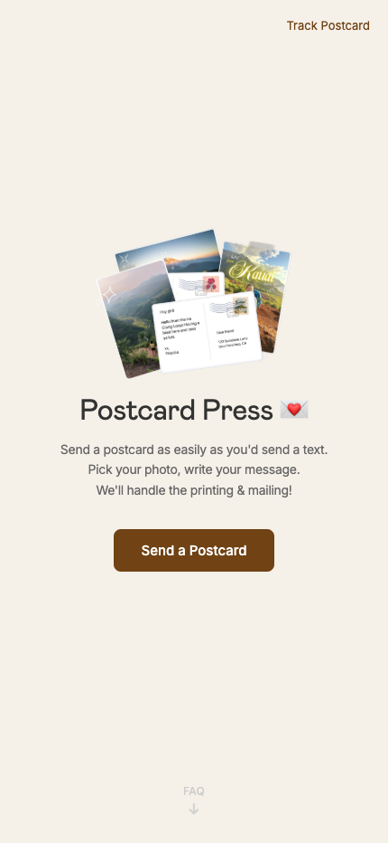
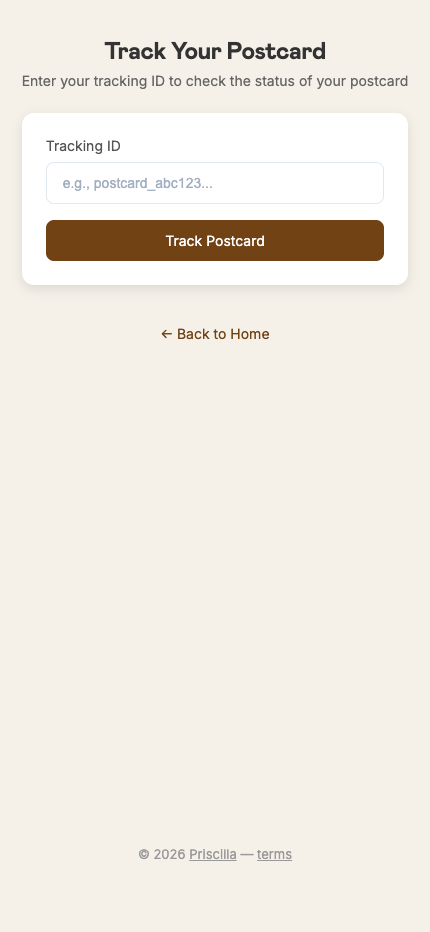

# Postcard Press 💌

Send a postcard as easily as you'd send a text. Pick a photo, write a message — Postcard Press handles printing and mailing a real, physical postcard to anywhere in the world.

**Live at [postcard-press.com](https://postcard-press.com)** — this is a live, paid product with real customers.

  
  

## What it does

- Upload a photo, write a message, enter a mailing address
- Pay for the postcard, we print and mail it via a print-on-demand mail API
- Track delivery status after it ships

## Stack

Node.js, Express, Stripe (payments), JWT auth, transactional email, PostGrid (print-and-mail API for physical delivery), deployed on Vercel.

## About this repo

The source for Postcard Press isn't public — it's a live service with real payment and anti-fraud logic that I'd rather not hand to anyone poking at it. This repo exists as a case study: what the product does, how it's built, and that it's shipped and generating revenue.
